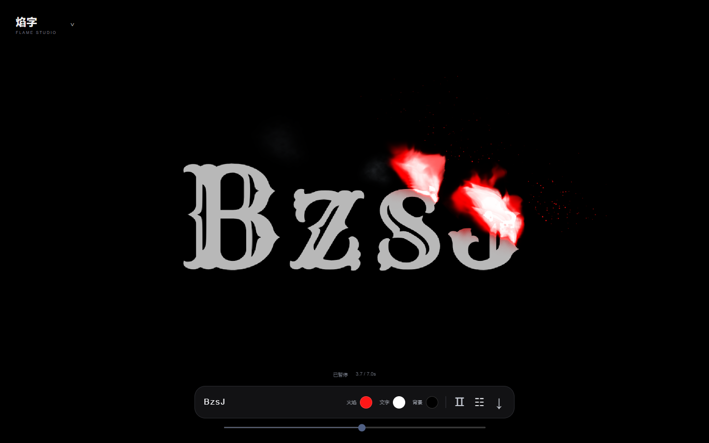
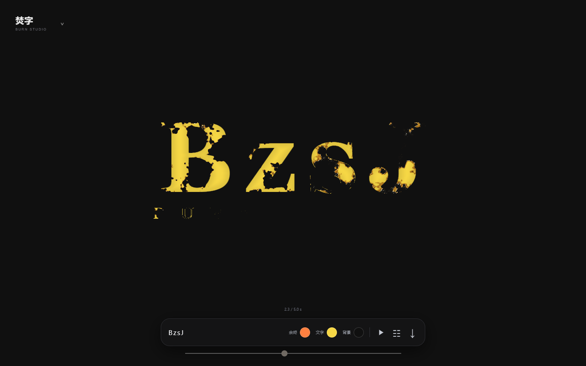

# BzsJ · 焰字 & 焚字

两种可以在浏览器中实时编辑的文字燃烧动画。完整 HTML / CSS / JavaScript / GLSL 源码，无构建步骤、无后端、无 API Key。

**[在线体验](https://1540696670-commits.github.io/bzsj-flame-burn-studio/) · [下载完整 ZIP](https://github.com/1540696670-commits/bzsj-flame-burn-studio/releases/latest) · [作者网站](https://1540696670.site)**

| 焰字 · Flame Studio | 焚字 · Burn Studio |
| --- | --- |
|  |  |
| 逐字燃烧，火焰、烟雾、火星与字形遮挡 | 文字烧蚀、余烬边缘与碎片消散 |

## 能做什么

- 修改文字、选择内置字体，或导入自己的 TTF / OTF / WOFF / WOFF2 字体。
- 分别设置文字、火焰 / 余烬、背景颜色。
- 调整文字大小；焰字还可以调整时长、火焰高度与辉光。
- 自动循环播放、暂停、拖动进度。
- 下载 MP4 动画。根据浏览器编码能力尝试最高 4K；实际尺寸、码率与耗时受设备限制。手机使用较轻的实时预览，高清导出仍可能较慢。
- 焚字支持副文字、自定义背景图片与当前画面截图。
- 导入字体和背景图片在本地浏览器处理，项目没有上传接口。

## 本地运行

下载 Release ZIP 并解压，选择一种方式：

```bash
# Python 3
python -m http.server 8000
# 打开 http://localhost:8000
```

或者使用 Node.js 18+，无需 npm install：

```bash
npm start
# 打开 http://localhost:4178
```

不要直接双击 HTML 使用 file://；字体和视频编码在 HTTP / HTTPS 环境更可靠。高清 MP4 导出建议使用新版桌面 Chrome 或 Edge。WebCodecs 通常要求 HTTPS 或 localhost；两种效果的预览都需要 WebGL。

## 项目结构

```text
flame/                焰字页面、体积火焰模拟和 GLSL 着色器
  app-v2.js           完整模拟、渲染与交互逻辑
  reference-glyphs.js 手绘近似展示字形，其他字符使用字体
  download.js         高清 MP4 导出
  fonts/              字体及各自许可
burn/                 焚字页面、距离场烧蚀与 GLSL 着色器
  app.js              字形距离场、渲染状态与交互
  download.js         高清 MP4 导出
  fonts/              字体及各自许可
studio-ui.*           统一工具栏、右侧设置与字体导入
effect-switch.*       页面切换、预热、闲置菜单彩蛋
mp4-muxer.js          本地 MP4 封装依赖
docs/                 参数、测量数据、校准记录、截图和清单
scripts/serve.mjs     零依赖本地服务器
```

## 参数与数据

- [焰字 v36 参数摘要](docs/flame-v36/parameters.json)
- [焰字公式与实现说明](docs/flame-v36/reference-data/单字火焰公式与实现.md)
- [Blender 参数拟合参考](docs/flame-v36/Blender参数参考.md)
- [焚字参数摘要](docs/burn-parameters.json)
- [历史校准数据](docs/flame-v36/validation/)

v36 文档记录的是历史基线；本仓库代码还包含集成网站时的界面、默认配色、移动预览和导出调整。**当前运行逻辑以源码及 `window.flameDemo.getState()` / `window.burnStudio.state` 为准**。截图测量、历史校准与拟合建议不是原作者工程或真实物理参数。浏览器随机火焰每轮会有所不同。

网页代码可直接复制到任意静态托管空间。公开版只提供焰字、焚字；原网站中的其他效果不在本仓库。参考视频、他人截图、账号配置、私人文件和开发中间缓存不属于本开源交付。

## 开源许可与致谢

项目原创代码使用 [MIT License](LICENSE)，可修改、分享和商用，分发时保留许可证。第三方字体、MP4 封装库的版权与许可分别保留，见 [THIRD_PARTY_NOTICES.md](THIRD_PARTY_NOTICES.md)。自行导入的字体和图片需由使用者确认相应使用权限。

这是网页效果实现与参数研究，不是参考作品原作者的源工程，也不表示对方参与或认可本项目。

**小红书 · 关注我 BzsJ**
